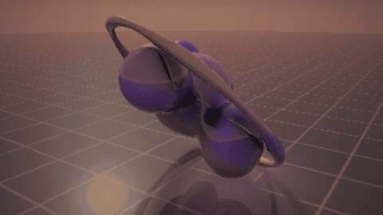

# Raymarch

A real-time 3D scene drawn by one fragment shader. There are no meshes and no 3D engine: every pixel shoots a ray into a mathematical description of the scene.

**▶ See it live: [jessyroest.github.io/raymarch](https://jessyroest.github.io/raymarch/)**

## What's in the shader

- **Signed distance fields**: the blobs, the ring and the floor are all just functions that return "how far is this point from the surface".
- **Smooth minimum** to melt the shapes into each other.
- **Sphere tracing** to find where each ray hits.
- **Soft shadows** and **ambient occlusion**, both computed by marching the same distance field.
- **One reflection bounce**, with Fresnel, so the sculpture shows up in the floor.
- Tone mapping, vignette and dithering to finish it off.

The JavaScript side is tiny: it draws one triangle that covers the screen, passes time and camera angles to the shader, and lowers the resolution automatically if your GPU can't keep up.

## Controls

Drag to orbit · scroll to zoom · **Change mood** swaps the lighting. It slowly orbits by itself when you leave it alone.

No build step, no libraries: open `index.html` in a browser with WebGL.
